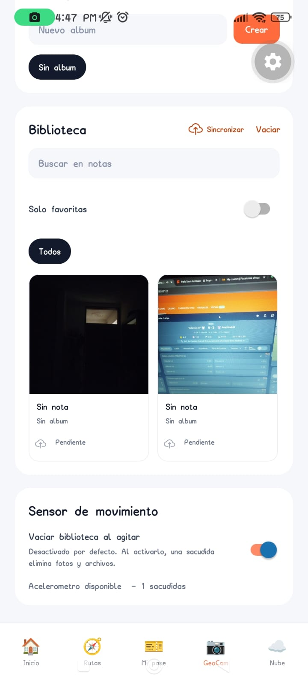
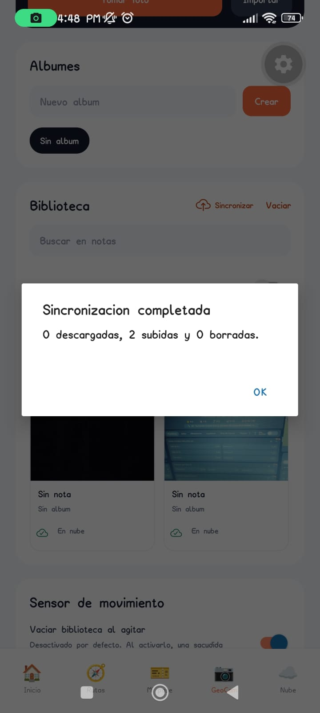
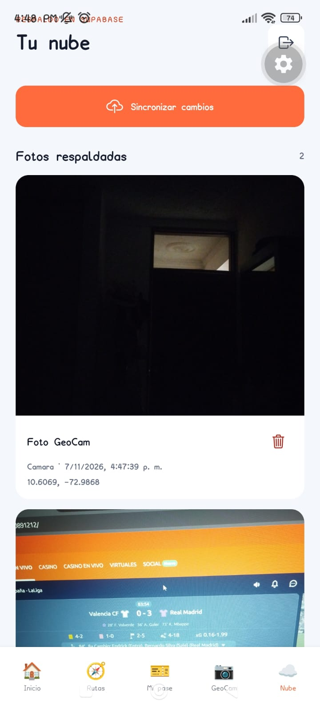

# Evidencias de GeoCam — Semana 9

Estas capturas corresponden a una prueba real en Android. Muestran dos fotos locales pendientes, su subida correcta a Supabase y su aparición en **Tu nube**.

## Evidencia disponible

### 1. Fotos locales pendientes

### 2. Sincronización completada

### 3. Fotos respaldadas en el feed de nube

Las capturas acreditan la subida y la consulta del feed en un dispositivo. No acreditan todavía la paginación ni la descarga en otro dispositivo.

## Verificación automatizada

- `npm test`: 10 pruebas aprobadas.
- `npx tsc --noEmit`: correcto.
- `npm run lint`: correcto.

Las pruebas cubren la resolución de conflictos/tombstones y el cursor de paginación. No sustituyen las comprobaciones del servidor real y de dos dispositivos.

## Evidencias pendientes para completar el recorrido

- **Paginación:** respaldar al menos 21 fotos, mostrar la primera tanda y cargar la página siguiente en **Tu nube**.
- **Sincronización hacia el dispositivo:** con la misma cuenta en el dispositivo B, sincronizar y mostrar una foto creada en A dentro de la biblioteca local de B.
- **Borrado offline:** en A, activar modo avión y borrar una foto ya respaldada; reconectar, sincronizar y mostrar que ya no aparece en B ni en la nube.
- **Borrado desde la nube:** borrar desde **Tu nube**, sincronizar B y mostrar que también desaparece de SQLite y del almacenamiento local de B.
- **Conflicto entre dispositivos** (si lo exige la rúbrica): editar la misma foto sin conexión en A y B, sincronizar y mostrar que ambos conservan la versión más reciente.

Para la entrega final, graba estos recorridos en el teléfono o toma capturas del resultado. No presentes estos escenarios como verificados hasta haberlos ejecutado.
