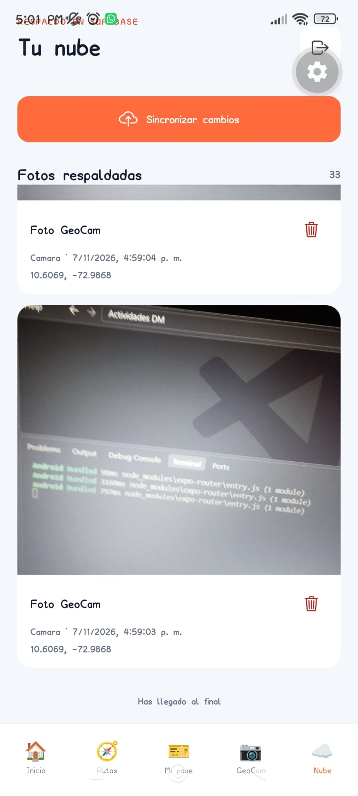
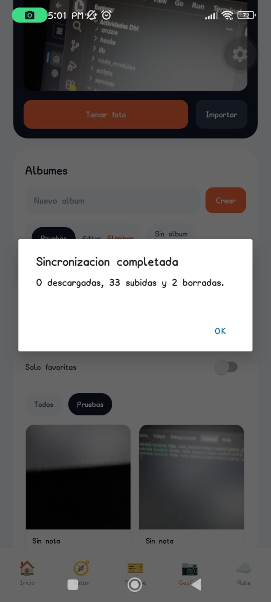

# Evidencias de GeoCam — Semana 9

Estas capturas corresponden a pruebas reales en Android. Muestran fotos locales pendientes, su subida a Supabase, el feed paginado con 33 respaldos y el resultado de sincronizar 33 subidas y 2 borrados.

## Evidencia disponible

### 1. Fotos locales pendientes

### 2. Sincronización completada

### 3. Fotos respaldadas en el feed de nube

### 4. Feed con 33 fotos y fin de lista

El contador muestra 33 respaldos y la pantalla muestra **Has llegado al final**. Esto acredita que el feed avanzó más allá de la primera página (20 elementos) hasta el final de los resultados en este dispositivo.

### 5. Resultado de sincronización con borrados

La app informó **0 descargadas, 33 subidas y 2 borradas**. Esto documenta que el ciclo de sincronización procesó y reportó subidas y borrados en el dispositivo probado.

Estas capturas no acreditan todavía la descarga en otro dispositivo ni que los dos borrados se hayan propagado y verificado en otro dispositivo.

## Verificación automatizada

- `npm test`: 10 pruebas aprobadas.
- `npx tsc --noEmit`: correcto.
- `npm run lint`: correcto.

Las pruebas cubren la resolución de conflictos/tombstones y el cursor de paginación. No sustituyen las comprobaciones del servidor real y de dos dispositivos.

## Evidencias pendientes para completar el recorrido

- **Sincronización hacia el dispositivo:** con la misma cuenta en el dispositivo B, sincronizar y mostrar una foto creada en A dentro de la biblioteca local de B.
- **Propagación del borrado offline:** en A, activar modo avión y borrar una foto ya respaldada; reconectar, sincronizar B y mostrar que ya no aparece en B ni en la nube.
- **Propagación del borrado desde la nube:** borrar desde **Tu nube**, sincronizar B y mostrar que también desaparece de SQLite y del almacenamiento local de B.
- **Conflicto entre dispositivos** (si lo exige la rúbrica): editar la misma foto sin conexión en A y B, sincronizar y mostrar que ambos conservan la versión más reciente.

Para la entrega final, graba estos recorridos en el teléfono o toma capturas del resultado. No presentes estos escenarios como verificados hasta haberlos ejecutado.
