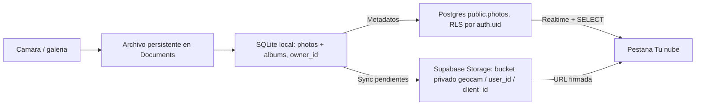
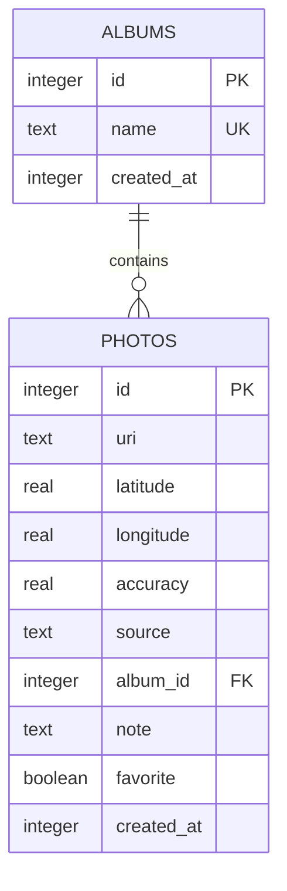
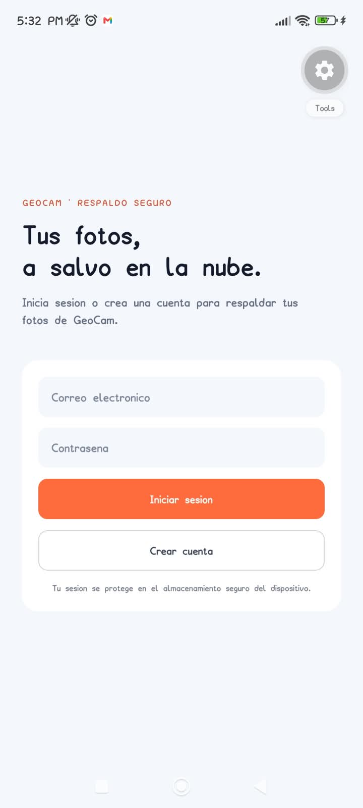

# GeoCam — Respaldo seguro de fotos (Semana 8)

App móvil construida con **Expo SDK 57** y **Expo Router**. GeoCam combina una galería local disponible sin conexión con autenticación y respaldo privado de imágenes en Supabase Storage.

> Los datos de demostración del mapa están ubicados en **Riohacha, La Guajira (Colombia)**.

**Repositorio:** https://github.com/LuisCardona29/Semana-6-DM

---

## 📑 Tabla de contenidos

1. [Características](#-características)
2. [GeoCam offline-first](#geocam-offline-first)
3. [Custom hooks](#-custom-hooks)
4. [Manejo de permisos](#-manejo-de-permisos)
5. [Evidencia visual](#-evidencia-visual)
6. [Checklist de verificación](#-checklist-de-verificación)
7. [Estructura del proyecto](#-estructura-del-proyecto)
8. [Cómo ejecutar](#-cómo-ejecutar)
9. [Tecnologías](#-tecnologías)
10. [Documentación de IA](#-documentación-de-ia)

---

## ✨ Características

| Pantalla | Qué hace |
|---|---|
| **Inicio** | Muestra el estado del servicio y los shuttles en ruta con su ETA y estado (*En tránsito*, *Listo*, *A tiempo*). |
| **Rutas** | Buscador de corredores, listado de líneas (*Operativa* / *Mantenimiento*), mapa nativo con calles, paradas y recorrido destacado, y botón **Ver detalles** hacia `student/[id]`. |
| **Mi pase** | Pase digital, panel de **permisos del dispositivo**, vista previa de cámara y **sensor de movimiento** (contador de sacudidas). |
| **GeoCam** | Captura o importa fotos, conserva los archivos en Documentos y guarda metadatos, coordenadas, notas, favoritos y álbumes en SQLite. |

La galería está disponible sin conexión: captura/importación, edición de notas, favoritos, asignación y gestión de álbumes, búsqueda y filtros reactivos.

### Mapa y pedidos en curso

- Mapa nativo con paradas, recorrido principal y botón de centrar ubicación.
- Pedidos activos con marcador, ETA y estado: `En camino`, `Listo` y `Demorado`.
- Coordenadas reales del usuario (`Lat / Lon`) cuando el GPS está activo.

### Correcciones realizadas

- La pestaña **Rutas** ahora funciona: permite buscar recorridos y abrir **Ver detalles**.
- El detalle de cada ruta navega a `student/[id]`.
- El GPS se solicita desde **Activar GPS**, **nunca al abrir la app**.
- Al conceder ubicación se muestran las coordenadas actuales.
- Si el permiso está bloqueado aparece **Abrir Ajustes**.
- La cámara sigue funcionando aunque la ubicación sea rechazada.
- GPS y acelerómetro limpian sus suscripciones al salir de la pantalla.

## GeoCam offline-first

La app requiere una cuenta para entrar a las pantallas privadas. Desde **Tu nube** se pueden sincronizar pendientes, consultar fotos respaldadas y cerrar sesión. Las credenciales de sesión persisten con Expo SecureStore. Las fotos se guardan en el bucket privado `geocam`, organizadas en una carpeta con el ID del usuario; RLS restringe filas y objetos a su propietario.

Para configurar el proyecto, copia `.env.example` a `.env` y agrega la URL de Supabase y una publishable key. Nunca uses una `service_role` o secret key en la app. Aplica `supabase/schema.sql` desde SQL Editor antes de sincronizar. `drizzle/0004_fair_sparrow.sql` agrega el propietario local de álbumes.

La comprobación automatizada de TypeScript pasa. Falta validar el registro y login contra Supabase, persistencia tras forzar el cierre, aislamiento con una segunda cuenta y el tamaño de archivos cargados en un dispositivo conectado al proyecto real.

### Diagrama local y remoto (Semana 8)



SQLite sigue siendo la fuente de verdad del dispositivo. El respaldo remoto requiere conexión; las filas y objetos remotos solo son visibles para su usuario autenticado. Al eliminar, primero se confirma la operación remota y luego se limpia el archivo y fila local.

### SQL de Supabase

El SQL completo e idempotente de la tabla, políticas RLS y bucket privado está en [`supabase/schema.sql`](supabase/schema.sql). Ejecútalo en el SQL Editor del proyecto antes de conectar la app. Las claves `service_role`/secret nunca se configuran en el cliente móvil.

### Auditoría de credenciales

- `git log --all --full-history -- .env`: sin resultados (el archivo nunca se versionó).
- `.env` y `.env.*` están ignorados; `.env.example` contiene nombres de variables y valores de ejemplo no válidos.
- El cliente usa únicamente `EXPO_PUBLIC_SUPABASE_URL` y `EXPO_PUBLIC_SUPABASE_PUBLISHABLE_KEY`; no hay secret key en código.

La lista de pendientes y los cambios recientes en fotos se sincronizan en serie con avance, sin registrar objetos vacíos. `Tu nube` consulta la cuenta actual, obtiene URLs firmadas y escucha cambios por Realtime. El GIF real del flujo debe añadirse como `assets/screenshots/geocam-cloud-flow.gif` después de grabarlo en un dispositivo conectado al proyecto.

Las escrituras se guardan primero en el dispositivo. La interfaz lee consultas reactivas desde SQLite; no depende de conexión a internet.

### Modelo de datos



Las fotos se copian a `Paths.document/geocam-photos/`; SQLite almacena su URI, coordenadas opcionales, origen, nota, favorito y album. Al borrar una foto se borra su archivo. Al borrar un album las fotos se conservan con `album_id = NULL`.

### Flujo

```text
Camara / selector de imagen
                -> copia del archivo a Documentos
                -> repositorio de fotos
                -> SQLite + useLiveQuery
                -> galeria GeoCam / marcadores del mapa
```

GeoCam permite crear, renombrar y eliminar albumes; buscar por nota; filtrar por album y favoritas; editar metadatos; y borrar fotos. La opcion **Vaciar biblioteca al agitar** es opt-in y viene apagada.

### Capturas de GeoCam


### Autenticación y respaldo (Semana 8)

La pantalla de acceso permite iniciar sesión o crear una cuenta. Las pantallas privadas requieren sesión y las credenciales de sesión se guardan con SecureStore en Android e iOS.



Para habilitar autenticación y respaldo, configura `.env` a partir de `.env.example` y ejecuta [`supabase/schema.sql`](supabase/schema.sql) en el SQL Editor de tu proyecto. El esquema aplica RLS a la tabla y al bucket privado `geocam`, con acceso limitado a la carpeta del usuario. La conexión remota, el registro/login y la sincronización deben validarse con el proyecto Supabase configurado.

### Migraciones

- `drizzle/0000_*.sql`: tabla inicial `photos`.
- `drizzle/0001_*.sql`: tabla `albums`, album opcional en fotos, nota y favorito.
- Los archivos y snapshots de `drizzle/` se generan con Drizzle Kit y deben versionarse. No edites una migracion ya generada.
- La segunda migracion generada registra `ON DELETE SET NULL` en el snapshot, pero Drizzle Kit no lo incluyo en el `ALTER TABLE` SQL de SQLite. El arranque instala un trigger idempotente que preserva ese comportamiento.

- `drizzle/0002_*.sql`: campos de sincronizacion local (`client_id`, `updated_at`, `remote_path`, `synced_at`).
- `drizzle/0003_*.sql` y `0004_*.sql`: propietario por usuario en fotos y albumes.
- `drizzle/0005_*.sql`: migracion de compatibilidad sin cambios; el arranque repara columnas faltantes de forma idempotente para bases actualizadas parcialmente.
- `supabase/schema.sql`: esquema remoto, RLS y politicas Storage; requiere aplicarse en el SQL Editor del proyecto Supabase.

Para generar una migracion despues de cambiar el esquema:

```bash
npm run db:generate
```

### GIF del flujo

El GIF debe grabarse en un dispositivo real para mostrar captura/importacion, cierre y reapertura de Expo Go, y persistencia de la foto. Guarda la grabacion como `assets/screenshots/geocam-offline-flow.gif` y anade aqui la imagen; no se incluye una animacion simulada como evidencia de persistencia.

---

## 🪝 Custom hooks

Toda la lógica nativa vive en `hooks/`, separada de la UI. Los hooks están **tipados (sin `any`)** y exponen los errores como **estado** para que la interfaz los muestre.

| Hook | Responsabilidad |
|---|---|
| [`hooks/useGeoLocation.ts`](hooks/useGeoLocation.ts) | Permiso de ubicación, coordenadas actuales, errores y *watcher* GPS con limpieza al desmontar. |
| [`hooks/useCamera.ts`](hooks/useCamera.ts) | Permiso de cámara, estados (concedido / rechazado / bloqueado) y acceso a Ajustes. |
| [`hooks/useShake.ts`](hooks/useShake.ts) | Detección de sacudidas con el acelerómetro y cancelación de la suscripción del sensor. |

### Buenas prácticas aplicadas

- **Permisos en contexto:** se piden solo cuando el usuario toca un botón (*Activar GPS*, *Solicitar permisos*).
- **Limpieza de suscripciones:** `remove()` / `unsubscribe` dentro del `return` de `useEffect`.
- **Errores como estado:** la UI nunca depende de `try/catch` aislados; lee el estado del hook.
- **Independencia entre permisos:** rechazar la ubicación no afecta a la cámara.

---

## 🔐 Manejo de permisos

La app distingue tres estados y muestra una respuesta distinta para cada uno:

| Estado | Comportamiento en la UI |
|---|---|
| ✅ **Concedido** | Se activa la función (coordenadas GPS, vista previa de cámara) y se muestra *"Los permisos están listos para usar la app"*. |
| ⚠️ **Rechazado** | Se informa al usuario, se permite volver a pedir con **Solicitar permisos** y el resto de la app (cámara) sigue funcionando. |
| 🚫 **Bloqueado** | Se explica que el permiso está bloqueado y aparece el botón **Abrir Ajustes** para habilitarlo manualmente. |

### Flujo de solicitud

```
Usuario toca "Activar GPS"  ──►  Diálogo nativo de Android
                                   ├─ Mientras la app está en uso / Solo esta vez ──► Concedido
                                   ├─ No permitir ───────────────────────────────► Rechazado
                                   └─ No permitir (repetido) ────────────────────► Bloqueado ──► "Abrir Ajustes"
```

---

## 📸 Evidencia visual

### Los tres estados de permiso

| ✅ Concedido | ⚠️ Rechazado | 🚫 Bloqueado |
|:---:|:---:|:---:|
|  |  |  |
| Ubicación y cámara concedidas | Ubicación rechazada, cámara sigue funcionando | Ubicación bloqueada con **Abrir Ajustes** |

### Estados en la pantalla Rutas

| Pendiente | Bloqueado | Concedido |
|:---:|:---:|:---:|
|  |  |  |
| Botón **Activar GPS** | Botón **Abrir Ajustes** | GPS activo con coordenadas |

### Solicitud de permiso en contexto


*Diálogo nativo mostrado únicamente tras tocar el botón, nunca al abrir la app.*

### Mapa y pedidos de Riohacha


### Navegación de la app

| Inicio | Listado de rutas | Cámara en Mi pase |
|:---:|:---:|:---:|
|  |  |  |

### Diagramas de estado de permiso

| Concedido | Rechazado | Bloqueado |
|:---:|:---:|:---:|
|  |  |  |

---

## ✅ Checklist de verificación

- [x] La app pide permisos **en contexto**, nunca al abrirse.
- [x] Si se niega la ubicación, **la cámara sigue funcionando** y la app lo comunica.
- [x] Existe un botón **"Abrir Ajustes"** cuando el permiso está bloqueado.
- [x] Todas las suscripciones (GPS, acelerómetro) se **limpian al salir** de la pantalla.
- [x] Los hooks están **tipados, sin `any`**, y los errores llegan a la UI como estado.
- [x] `hooks/useGeoLocation.ts`, `hooks/useCamera.ts` y `hooks/useShake.ts` presentes.
- [x] README con capturas de los tres estados de permiso.
- [x] `AI-LOG.md` con la bitacora de las Semanas 6, 7 y 8 en la raiz.
- [x] GeoCam usa SQLite/Drizzle, dos migraciones generadas, repositorios y fotos en almacenamiento permanente.
- [x] Albumes relacionados, nota, favorito, filtros reactivos y borrado de registros/archivos implementados.
- [x] Pantalla de autenticacion implementada; la captura esta en `assets/screenshots/13.png`.
- [ ] Aplicar el SQL remoto y verificar registro/login, SecureStore tras cierre, RLS con segunda cuenta y carga de imagenes en Supabase.
- [ ] Probar en el telefono que las fotos sobreviven al cierre de Expo Go y grabar `assets/screenshots/geocam-offline-flow.gif`.

---

## 🗂️ Estructura del proyecto

```
Semana-6-DM/
├── app/                    # Pantallas (Expo Router)
│   ├── (tabs)/             # GeoCam · Rutas · Tu nube
│   ├── login.tsx           # Inicio de sesion y registro
│   └── student/[id]        # Detalle de ruta
├── hooks/
│   ├── useGeoLocation.ts   # GPS + permiso de ubicación
│   ├── useCamera.ts        # Cámara + permiso
│   └── useShake.ts         # Acelerómetro / sacudidas
├── db/
│   ├── schema.ts           # photos y albums
│   ├── client.ts           # SQLite + Drizzle
│   └── repositories/       # Acceso a datos
├── drizzle/                # SQL y snapshots generados
├── services/photoFiles.ts  # Archivos permanentes
├── hooks/usePhotos.ts      # Consultas y acciones de GeoCam
├── assets/
│   ├── screenshots/        # Capturas de la entrega (1.png – 13.png)
│   └── permission-state/   # granted.svg · denied.svg · blocked.svg
├── AI-LOG.md               # Bitácora de uso de IA (Semana 6)
└── README.md
```

## 🚀 Cómo ejecutar

```bash
npm install
npx expo start -c
```

1. Instala **Expo Go** compatible con **SDK 57** en un dispositivo físico.
2. Escanea el código QR que aparece en la terminal.
3. Abre **GeoCam** para capturar/importar fotos, asignar álbum y nota, o marcar favoritas.
4. Cierra Expo Go por completo y vuelve a abrirlo; las fotos deben seguir en la biblioteca y sus marcadores en **Rutas**.
5. Prueba modo avión, búsqueda, filtros y borrado de fotos/álbumes.

> ⚠️ GPS, cámara y acelerómetro requieren **dispositivo físico**; los emuladores no los reproducen de forma fiable.

---

## 🛠️ Tecnologías

- Expo SDK 57
- Expo Router
- React Native
- Expo Camera
- Expo Location
- Expo Sensors
- Expo SQLite
- Drizzle ORM y Drizzle Kit
- Expo FileSystem
- Expo ImagePicker
- TypeScript (modo estricto)

---

## 🤖 Documentación de IA

El uso de herramientas de IA durante esta semana está documentado en [`AI-LOG.md`](AI-LOG.md), en la raíz del repositorio.
